# Lab Checkpoint 0：Networking Warmup 实验报告

## 1. 实验内容

本次实验主要包括：通过 telnet 手动发送 HTTP 请求；使用 netcat 和 telnet 观察本地 TCP 双向通信；实现简单 HTTP 客户端 webget；实现具有容量限制的内存字节流 ByteStream，并运行功能与性能测试。

## 2. 手动进行网络通信

### 2.1 Fetch a Web page

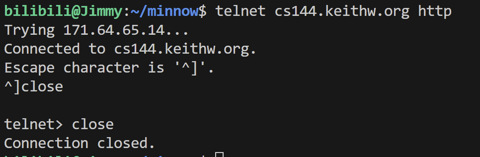

重新连接后，依次输入以下 HTTP 请求，最后再输入一个空行。服务器返回 `HTTP/1.1 200 OK`，正文为 `Hello, CS144!`，随后关闭连接，说明请求成功。

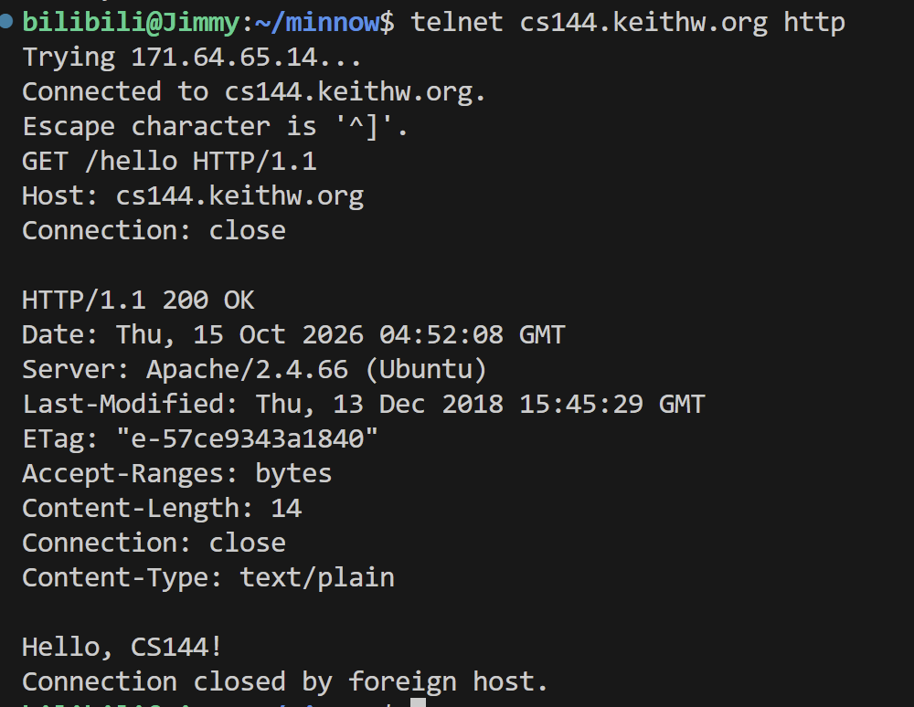

### 2.2 Listening and connecting

在一个终端启动 netcat，监听本机的 9090 端口：

```bash
netcat -v -l -p 9090
```

另一个终端执行：

```bash
telnet localhost 9090
```

连接建立后，netcat 显示连接来自 `localhost`，客户端端口为 `35565`；telnet 显示已连接到 `localhost`。服务端监听端口和客户端临时端口承担不同作用。

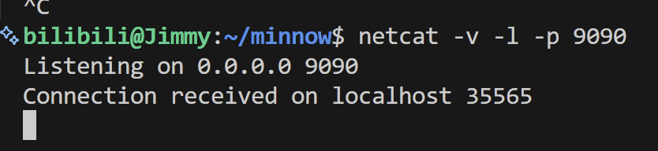

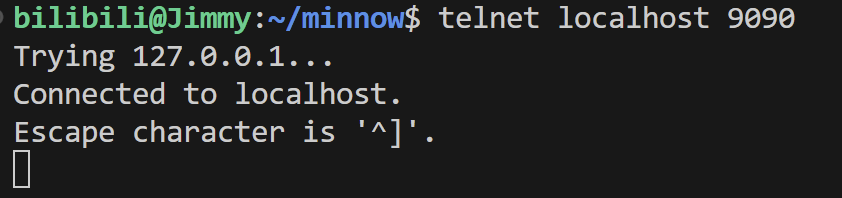

在 telnet 端输入 `111` 并按回车后，netcat 端也显示了相同内容。

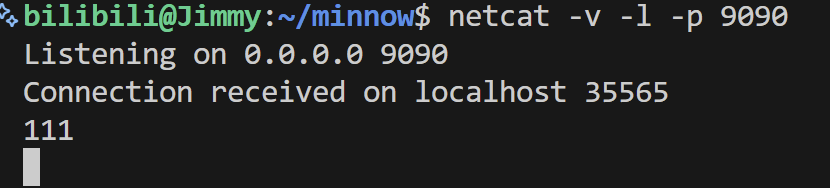

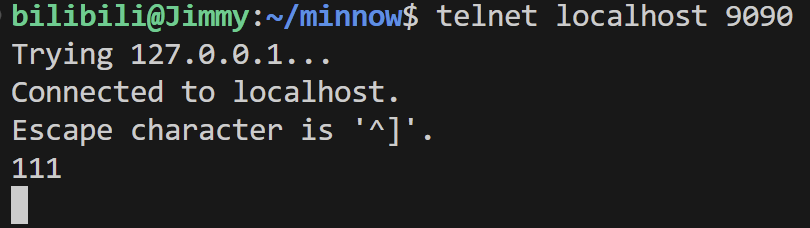

随后在 netcat 端输入 `222` 并按回车，telnet 端也显示了 `222`。这说明同一个 TCP 连接的两端都可以发送和接收数据，客户端和服务端并不是固定的“发送端”和“接收端”。

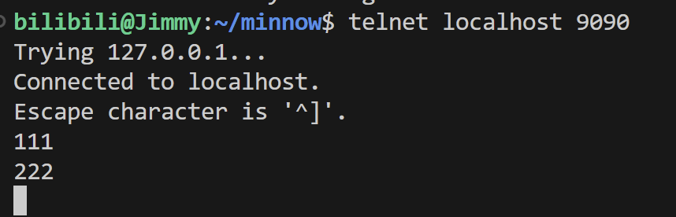

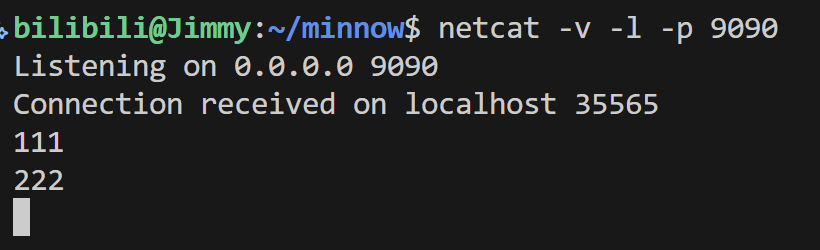


在 netcat 端按 `Ctrl+C` 结束程序后，telnet 端提示 `Connection closed by foreign host.`，表明对端关闭了连接。

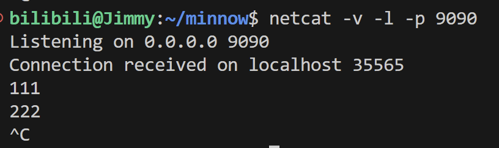

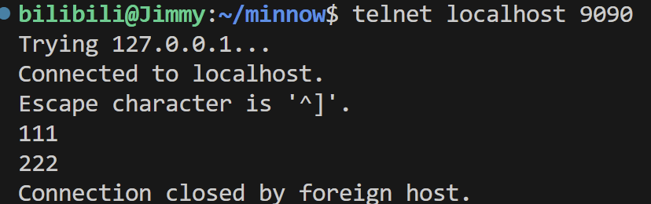

## 3. 使用操作系统的 TCP 支持实现 webget

### 3.1 接口理解

阅读 `util/socket.hh` 和 `util/file_descriptor.hh` 后，梳理了以下概念：

- 文件描述符是操作系统供进程使用的非负整数，用来标识已经打开的资源；socket 也是其中一种资源。
- `FileDescriptor` 封装底层文件描述符，提供读写、关闭和状态查询等操作，并管理资源生命周期。
- `Socket` 继承 `FileDescriptor`，`TCPSocket` 继承 `Socket`，因此 TCP socket 可以使用继承来的 `read()` 和 `write()`。
- `bind()` 指定本地地址和端口；`connect()` 指定对端地址并主动建立 TCP 连接。普通客户端通常不需要显式调用 `bind()`，操作系统会选择本地地址和临时端口。

以 `http://cs144.keithw.org/hello` 为例，主机名 `host` 为 `cs144.keithw.org`，资源路径 `path` 为 `/hello`。

### 3.2 处理流程

`get_URL()` 的处理流程为：创建 `TCPSocket`，通过 `Address(host, "http")` 解析并连接服务器，发送 HTTP GET 请求，再持续读取并输出响应，直到 EOF。

请求包含 `Host` 和 `Connection: close`，每行使用 `\r\n` 结束，最后使用额外的 `\r\n` 表示请求头结束。

读写过程中需要注意：

1. 一次 `write()` 不保证写入所有数据，它返回实际写入的字节数。因此用 `string_view remaining` 表示尚未写入的部分，循环写入，并根据返回值调整视图。
2. `string_view` 只查看原字符串，不复制内容；`remove_prefix()` 调整视图，不修改原请求字符串。
3. 一次 `read()` 也不保证得到完整响应，所以需要循环读取。服务器发送完响应并结束发送方向后，客户端读完已有数据，再通过读取检测到 EOF。

### 3.3 获取页面与结果对比

在项目根目录编译：

```bash
cmake --build build
```

进入 `build/` 目录运行：

```bash
./apps/webget cs144.keithw.org /hello
```

返回的正文为 `Hello, CS144!`。与浏览器直接访问相比，webget 还会打印 HTTP 状态行和响应头，例如：

```http
HTTP/1.1 200 OK
Date: Sat, 17 Oct 2026 06:54:21 GMT
Server: Apache/2.4.66 (Ubuntu)
Last-Modified: Thu, 13 Dec 2018 15:45:29 GMT
ETag: "e-57ce9343a1840"
Accept-Ranges: bytes
Content-Length: 14
Connection: close
Content-Type: text/plain
```

其中，`Content-Length: 14` 表示响应正文长度为 14 字节，`Content-Type: text/plain` 表示正文为纯文本。webget 与 2.1 中手动发送请求得到的响应结构一致；浏览器通常只显示解析后的正文。

### 3.4 访问其他网站

在 `build/` 目录中额外测试：

```bash
./apps/webget www.baidu.com /
./apps/webget www.bilibili.com /
```

响应分别保存在 [百度响应记录](./baidu.txt) 和 [B 站响应记录](./bilibili.txt) 中。

| 网站 | 本次返回的状态 | 观察结果 |
| --- | --- | --- |
| 百度 | 200 OK | 返回首页 HTML 源码，包括页面样式和脚本等内容，输出明显长于 /hello。 |
| B 站 | 301 Moved Permanently | Location 为 https://www.bilibili.com/，要求改用 HTTPS 访问。 |

B 站的 301 是有效的 HTTP 重定向响应，并非 TCP 连接失败。浏览器会跟随跳转，而当前 webget 只输出收到的响应，未实现自动重定向和 HTTPS 所需的 TLS 支持，所以不会继续获取 HTTPS 页面。

### 3.5 自动测试结果

在项目根目录执行：

```bash
cmake --build build --target check_webget
```

编译检查和 `t_webget` 均通过，共 2 项测试，失败数为 0。

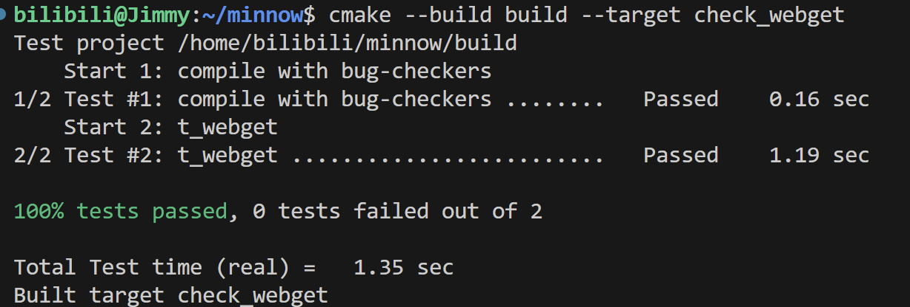

## 4. An in-memory reliable byte stream

### 4.1 目标与接口

ByteStream 在单线程、单机内存中提供按序传递字节的抽象。写入的数据由读取端按原顺序取出，且未读取的字节数不能超过构造时指定的容量。

容量限制的是当前缓冲的数据量。读取端移除数据后，写入端可以继续利用释放的容量。

写入端通过 `push()` 写入数据，`close()` 表示后续不再写入；读取端通过 `peek()` 查看当前可读内容，通过 `pop()` 移除已读数据。只有写入端已关闭且缓冲区已空时，`is_finished()` 才返回真。

### 4.2 实现要点

当前实现将状态成员放在 `ByteStream` 基类中，由 `Writer` 和 `Reader` 接口共享：

- 使用 `deque<string>` 按顺序保存写入的数据块。
- 使用 `front_offset_` 记录首个数据块中已经移除的字节数。
- 使用 `bytes_pushed_` 和 `bytes_popped_` 分别记录累计写入、移除的字节数。
- 使用 `closed_` 记录写入端是否关闭。

状态之间满足以下关系：

```text
当前缓冲字节数 = 累计写入字节数 - 累计移除字节数
当前可用容量   = 总容量 - 当前缓冲字节数
读取结束       = 写入端已关闭 且 当前缓冲字节数为 0
```

`push()` 最多接收当前可用容量允许的前缀，空数据或没有可用容量时不加入新数据块。关闭写入端后，不再接受写入。

`peek()` 返回首块尚未读取部分的 `string_view`，不移除数据，也不要求一次返回全部缓冲内容。`pop()` 可以跨多个数据块移除字节；首块被完全移除后，将其从队列中弹出，并重置偏移量。

使用偏移量可以避免每次少量读取时都删除字符串前缀、搬移剩余字符，从而减少不必要的操作。

### 4.3 功能和性能测试

在项目根目录执行：

```bash
cmake --build build --target check0
```

本次截图记录的吞吐量为 13.82 Gbit/s，超过实验要求的 0.1 Gbit/s。

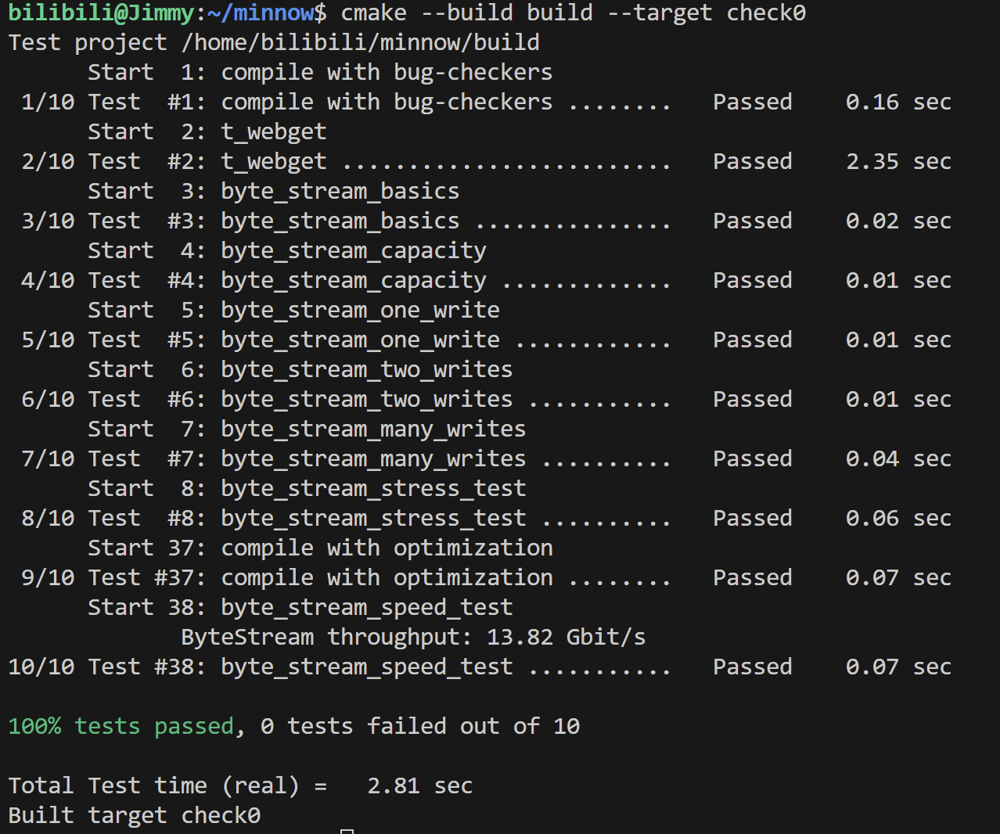
