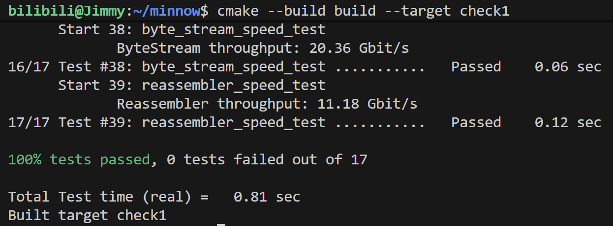

# Check1 实验报告

## 1. 实验目标

本次实验在 Checkpoint 0 的 ByteStream 基础上实现 Reassembler，将乱序、重复或重叠的数据片段还原为连续字节流。每个片段都带有起始字节索引，Reassembler 据此确定它的位置，并将连续的数据写入 ByteStream，供上层应用读取。

连续的数据应立即输出，暂时存在缺口的数据保存在容量窗口内，超出窗口的部分丢弃。缓存中的每个字节只保存一份。收到结束标记后，还要等终点之前的数据全部输出，才能关闭写入端。

## 2. 方案尝试与性能比较

双数组版本通过了功能测试，吞吐量为 1.47 Gbit/s。随后将缓存改为按字符串片段存储的 map，最终测得 11.18 Gbit/s。

### 2.1 双数组环形缓存

双数组方案使用 `vector<char>` 保存字节，使用 `vector<bool>` 标记对应位置是否存在待组装数据。字节索引通过取模映射到固定大小的缓存槽位：

```text
缓存槽位 = 完整流中的字节索引 % 缓存大小
```

插入时逐字节检查标记，保存尚未收到的字节，并增加待组装计数。输出时从下一个等待输出的索引开始，连续读取有效槽位，遇到缺口就停止。已输出槽位的标记随之清除，供后续窗口复用。

双数组版本通过了 check1 的全部检查，测得 Reassembler 吞吐量为 1.47 Gbit/s，超过实验最低要求的 0.1 Gbit/s。

这个版本收到较长片段时，仍需逐字节取模、检查标记并读写缓存，输出时再逐字节拼接字符串，性能开销较大。

### 2.2 改用 map 按片段缓存

最终版本使用 `map<uint64_t, string>`，键为片段起始索引，值为字符串内容。map 按索引排序，处理时可以依次检查片段之间的缺口。

插入时，按起始索引检查已有缓存，只保存尚未覆盖的部分。输出时，根据下一个待输出索引查找片段，将整个连续片段移动到 ByteStream，再删除对应缓存项。这样可以按片段处理数据，减少逐字节检查和拼接。

最终测得吞吐量为 11.18 Gbit/s，性能远超双数组方案。



## 3. 最终数据结构与设计

### 3.1 成员变量

| 成员 | 作用 |
| --- | --- |
| `output_` | 保存已经按顺序重组的数据，通过 Reader 供上层读取 |
| `pending_` | 保存乱序到达、尚不能输出的片段，各片段非空且互不重叠 |
| `pending_bytes_` | 记录缓存中的不同字节数，使 `bytes_pending()` 可以直接返回结果 |
| `end_index_` | 保存完整字节流末尾后一位的索引；无值表示终点未知 |

相邻片段分别保存，输出位置推进到它们的起点后，就能依次写入，无须先合并字符串。

### 3.2 接收窗口与容量限制

设累计写入输出流的字节数为 N，输出流当前可用容量为 A，则接收窗口为 `[N, N + A)`。

新片段的有效范围为：

```text
begin = max(first_index, N)
end   = min(first_index + data.size(), N + A)
```

索引小于 N 的字节已经输出，插入时跳过；索引大于等于 N + A 的字节超出窗口，直接丢弃。配合窗口内的去重处理，待组装数据与 ByteStream 中尚未读取的数据合计不超过容量。

上层应用读取数据后，ByteStream 的可用容量增加，接收窗口右边界向前移动。此前丢弃的字节需要重新接收。

### 3.3 重叠去重与连续输出

插入有效片段时，按索引遍历已有缓存，只将其中尚未覆盖的区间加入 map。例如，已有 `[3, 5)` 和 `[7, 9)`，新到达 `[2, 10)` 时，只新增 `[2, 3)`、`[5, 7)` 和 `[9, 10)`。

检查过程中插入的片段位于当前片段之前，后续扫描不会重复处理它们。缓存更新完成后，再输出并删除连续片段。

以 `output.bytes_pushed()` 为键查找下一个可输出片段。找到后，将其移入 ByteStream，减少待组装计数并删除缓存项。累计输出量随之增加，继续按新的位置查找，直到遇到缺口。

### 3.4 结束标记

收到 `is_last_substring` 时，先记录终点 `first_index + data.size()`，再裁剪片段。结束信息独立于数据保存，因此片段被裁剪后仍能保留终点。

终点已知且累计输出字节数等于终点时，调用 `close()`。这一条件适用于空流，也能处理结束片段提前到达或超出接收窗口的情况。写入端关闭后，上层仍可读取 ByteStream 中剩余的数据。

## 4. 理解与实现中的关键点

待组装数据与已输出数据分别存放：`pending_` 保存前面还有缺口的片段，`output_` 保存已经连续、可供上层读取的数据。`bytes_pending()` 只统计前者。

确定下一个待输出位置时，应使用累计输出量。`bytes_pushed()` 在上层读取后仍保持不变，可以作为完整流中的字节索引；当前缓冲量会随读取减少，适合用于计算可用容量。

去重直接影响容量与字节计数。只插入已有缓存未覆盖的区间，可以保证每个字节保存一次，待组装计数也只增加新增部分的长度。

结束片段可能先于其他片段到达，因此结束标记只用于确定终点。前面的缺口补齐并输出后，才满足关闭条件。

## 5. 测试与结果

在项目根目录执行：

```bash
cmake --build build --target check1
```

最终测试结果为：

```text
100% tests passed, 0 tests failed out of 17
Reassembler to ByteStream with capacity=1500 reached 11.18 Gbit/s.
```

17 项检查全部通过，涵盖带错误检查的编译、ByteStream 功能测试、Reassembler 的单片段、容量、顺序、重复、缺口、重叠和窗口测试，以及优化编译和两项吞吐量测试。

## 6. 剩余问题与局限

现有测试未发现功能错误。实现沿用实验对片段内容一致性的假设；索引与长度相加超出 `uint64_t` 表示范围的情况尚未添加检查。

当前实现从 map 开头扫描，缓存片段多时会增加插入耗时。设已有片段数为 K，新增片段数为 G，扫描的最坏时间复杂度为 $O(K)$，map 插入另有约 $O(G \log(K + G))$ 的开销，以及字符串复制成本。后续可通过定位相关片段，减少无关扫描。
