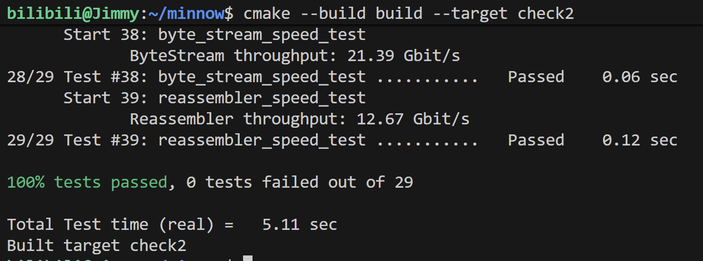

# Check2 实验报告

## 1. 程序结构与设计（Program Structure and Design）

本次实验在 ByteStream 和 Reassembler 的基础上实现 TCP Receiver。TCP Receiver 将报文中的 32 位序列号转换为字节流下标，把数据交给 Reassembler，再根据接收进度生成确认号、接收窗口和错误标志。

主要修改如下：

| 文件 | 实现内容 |
| --- | --- |
| `src/wrapping_integers.cc` | 实现 `wrap()` 和 `unwrap()`，转换 TCP 序列号与绝对序列号 |
| `src/tcp_receiver.hh` | 增加 `std::optional<Wrap32> isn_`，保存第一个 SYN 的初始序列号 |
| `src/tcp_receiver.cc` | 实现 `receive()` 和 `send()`，连接报文处理与字节流重组 |

### 1.1 三种编号的区别

TCP 序列号从发送方选定的 ISN 开始，使用 32 位无符号整数，超过 $2^{32}-1$ 后回到 0。绝对序列号从 SYN 的位置 0 开始，记录接收进度，使用 64 位整数。字节流下标只给数据编号，从第一个数据字节的 0 开始，SYN 和 FIN 都没有字节流下标。

例如，ISN 为 $2^{32}-2$，发送内容为 `cat`：

| 元素 | SYN | c | a | t | FIN |
| --- | --- | --- | --- | --- | --- |
| TCP 序列号 | $2^{32}-2$ | $2^{32}-1$ | 0 | 1 | 2 |
| 绝对序列号 | 0 | 1 | 2 | 3 | 4 |
| 字节流下标 | — | 0 | 1 | 2 | — |

区分三种编号后，序列号回绕与 SYN、FIN 的偏移可以分别处理。

### 1.2 序列号转换

#### 1.2.1 Wrap

设 $M=2^{32}$，`wrap()` 按以下关系转换：

$$
\mathrm{seqno}=(n+\mathrm{ISN})\bmod M
$$

实现使用 `static_cast<uint32_t>(n)` 保留低 32 位，再利用 `Wrap32` 的加法运算完成回绕。

#### 1.2.2 Unwrap

`unwrap()` 先计算相对于 ISN 的 32 位偏移：
$$
r=(\mathrm{seqno}-\mathrm{ISN})\bmod M
$$

对应的绝对序列号可能为 $r$、$r+M$、$r+2M$ 等，因此需要选择距离 `checkpoint` 最近的一个。实现先构造与参考点位于同一圈的候选值：

$$
c=\left\lfloor\frac{\mathrm{checkpoint}}{M}\right\rfloor M+r
$$

如果候选值与参考点相差超过半圈，则检查相邻一圈：候选值偏大时减去 $M$，偏小时加上 $M$。加减前检查 `uint64_t` 的上下界。恰好相差半圈时保留当前候选值，此时两个候选值距离相同。

### 1.3 receive()

`receive()` 负责处理控制标志和转换编号，乱序缓存、去重、容量裁剪及连续输出继续由 Reassembler 完成。

首先处理 RST。如果收到 RST 或字节流已有错误，就设置错误状态并结束本次处理。

接着检查 ISN。`isn_` 为空时，只有带 SYN 的报文才能建立序列号基准；普通报文直接忽略。使用 `optional` 可以区分“尚未收到 SYN”和“ISN 恰好为 0”。ISN 一旦记录，就不会被后续 SYN 覆盖。

展开序列号时，使用以下参考点：

```cpp
const uint64_t checkpoint = writer().bytes_pushed() + 1;
```

`bytes_pushed()` 是已经连续重组完成的字节数，也是下一个待重组字节的流下标。加上 SYN 占用的一个位置后，它就成为接近当前接收进度的绝对序列号。

随后计算 payload 的起始流下标：

```cpp
const uint64_t stream_index = message.SYN ? absolute_seqno : absolute_seqno - 1;
```

不带 SYN 时，报文序列号指向 payload 的第一个字节，需要减去 SYN 占用的位置。带 SYN 时，报文序列号指向 SYN，payload 位于它的下一个位置，转换后流下标恰好等于该报文的绝对序列号。绝对序列号为 0 且不带 SYN 时提前返回，避免无符号减一发生下溢。

最后将起始下标、payload 和 FIN 交给 `Reassembler::insert()`。使用 `move()` 移交字符串。FIN 用来确定数据流终点，只有终点之前的数据全部重组完成，写入端才会关闭。

### 1.4 send()

`send()` 构造并返回 `TCPReceiverMessage`，其中包含确认号、接收窗口和 RST。实际发送由调用方完成。

收到 SYN 后，确认号按以下公式计算，再通过 `wrap()` 转换为 32 位序列号：

```cpp
const uint64_t absolute_ackno = writer().bytes_pushed() + 1 + writer().is_closed();
```

其中，连续重组的字节数代表已经接收的数据，固定加一对应 SYN；写入端关闭后再加一，对应已经完整接收的 FIN。尚未收到 SYN 时，确认号保持为空。

确认号指向下一个需要的序列号。例如 ISN 为 100，只收到 SYN 时确认号为 101；连续收到 `cat` 后为 104；再完整收到 FIN 后为 105。乱序到达的数据不会越过前面的缺口推进确认号。

窗口大小取 `writer().available_capacity()`，上限为 `UINT16_MAX`，然后转换为 `uint16_t`。先限制数值范围再转换，可以避免高位被直接截断。乱序数据仍位于当前接收窗口内，窗口大小不再额外扣除 `bytes_pending()`。RST 则直接反映字节流的错误状态。

## 2. 实现中的难点（Implementation Challenges）

### 2.1 理解回绕和 checkpoint

开始阅读表格时，主要疑问是 wrapping 与 non-wrapping 的含义。结合跨越 $2^{32}$ 边界的 `cat` 示例，可以看出 TCP 序列号会回到 0，而绝对序列号持续记录实际位置。

进一步实现 `unwrap()` 时，需要理解一次取模会丢失圈数信息。例如 ISN 为 0 时，序列号 5 可以对应绝对序列号 5、$M+5$ 或 $2M+5$。`checkpoint` 提供接收进度参考，从中选择最近的候选值。它不要求与答案相等。

实现中使用无符号差值比较距离，并在加减一圈前检查边界，避免通过有符号转换计算大整数距离，也避免候选值调整时溢出。

### 2.2 正确处理 SYN 和 FIN

SYN 与 FIN 都占用序列号，但不属于 payload。最容易出错的地方是把报文起始序列号直接当成数据下标，以及收到 FIN 后立即推进确认号。

实现通过区分报文是否带 SYN 来计算 payload 下标，并把 FIN 交给Reassembler。`send()` 依据 `writer().is_closed()` 判断 FIN 是否已经可以确认，因此 FIN 即使提前到达，也要等前面的缺口补齐后才计入确认号。

SYN、数据和 FIN 可以出现在同一报文中。记录 ISN 后继续处理 payload 和 FIN，可以覆盖空流以及单个报文携带完整数据流的情况。

### 2.3 区分累计进度与当前缓冲量

计算 checkpoint 和确认号需要使用累计写入量 `bytes_pushed()`。应用读取数据后，这个值保持不变，接收进度也不会倒退。

接收窗口则使用剩余容量。应用读取缓冲数据后，可用容量增加，接收方就能允许发送方继续发送。将接收进度与缓冲占用分别计算，可以保持确认号和窗口含义一致。

### 2.4 调试与测试

实现 `receive()` 后，先用临时独立测试检查 9 种场景，包括 SYN 前的数据、SYN 携带数据和 FIN、乱序补齐、重复 SYN 与重传、跨越序列号回绕边界、空流关闭、容量限制，以及建立基准前后的 RST。测试启用了 AddressSanitizer 和 UndefinedBehaviorSanitizer。

独立测试首次编译时缺少 `byte_stream_helpers.cc`，出现链接错误；补齐链接依赖后，9 种场景全部通过。完成 `send()` 后，再运行仓库的完整 `check2`，验证接收逻辑、反馈消息与Reassembler的配合。

在项目根目录执行：

```bash
cmake --build build --target check2
```

29 项测试全部通过，测试截图如下：



## 3. 剩余问题（Remaining Bugs）

当前 `check2` 的全部检查通过，未发现实验测试范围内的功能错误。
